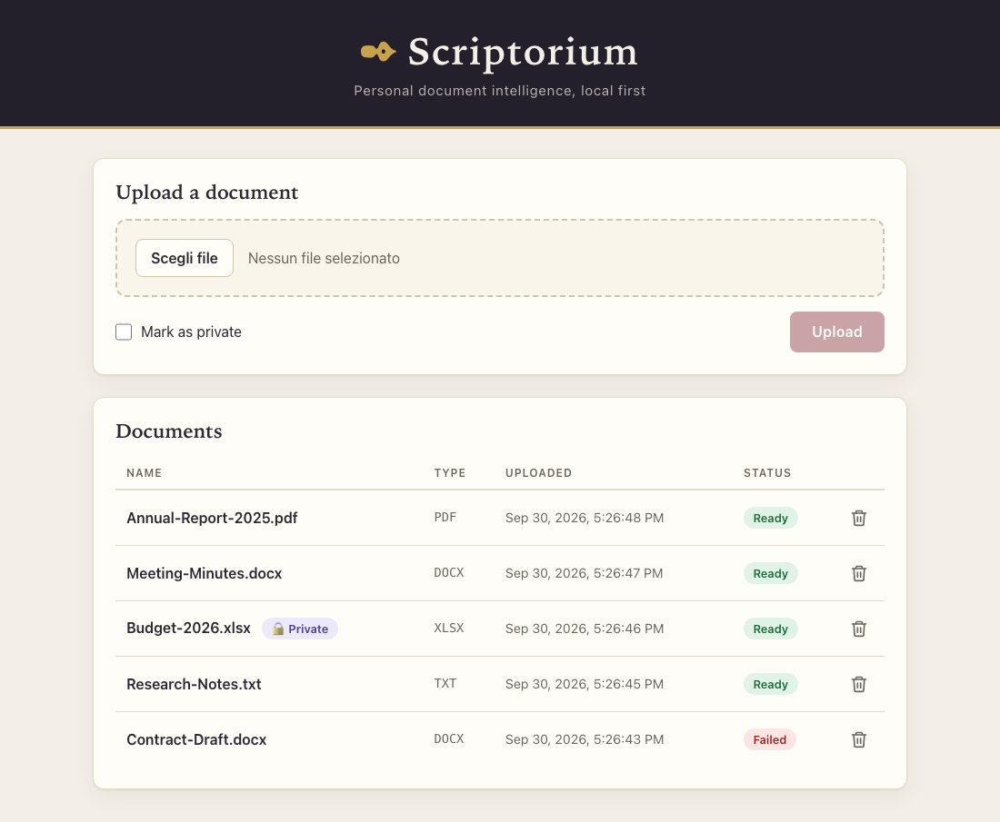

<div align="center">

# ✒ Scriptorium

**Personal document intelligence — local first.**

Upload your documents, keep them on your own machine, and let them become
something you can question, summarize and mine for entities.


[](https://github.com/github/spec-kit)

<picture>
  <source media="(prefers-color-scheme: dark)" srcset="docs/images/screenshot-dark.png">
  
</picture>

</div>

---

## ✨ What it does today

- 📄 **Upload** PDF, Word (`.docx`), Excel (`.xlsx`) and plain-text (`.txt`) files, up to 50 MB (configurable).
- ⚙️ **Extracts the text in the background.** Every document moves from *processing* to *ready*,
  or to *failed* with a human-readable reason (encrypted PDF, corrupted file, no extractable text…).
- 🗂 **Keeps the original and the text apart:** the file stays on disk, the extracted text lives in the database.
- 🔒 **Private flag** per document. It is stored now and will force the local model once routing exists.
- ♻️ **Rejects duplicates** by content (SHA-256), even when the file was renamed, and tells you which document it matches.
- 🗑 **Deletes documents** (record, extracted text and file) with a confirmation in the row.
- 📊 **Live list** that refreshes while documents are processing, with a progress bar during upload,
  clear error messages, and a dark theme that follows your system.
- 💬 **Asks questions about a document.** Click **Ask** on a ready document and chat with it: the answer is
  based only on the document's text, and it says so when the document does not contain the answer.
  Follow-up questions keep the context of the conversation; **New conversation** starts over, and the
  conversation is forgotten when you close the panel or reload the page.
- 🏠 **Runs on your machine.** Questions and document text go only to the local [Ollama](https://ollama.com)
  server, nothing leaves your computer.

## 🗺 Roadmap

| | Feature | Status |
|---|---|---|
| ✅ | Document upload and parsing | Done |
| ✅ | Ask questions about a document | Done |
| ⬜ | Summaries | Planned |
| ⬜ | Entity extraction | Planned |
| ⬜ | Model router: private documents → local **Ollama**, complex tasks → **Claude API**, manual override | Planned |
| ⬜ | Docker Compose setup (with an Ollama service) | Planned |

Scriptorium is single-user and local-first: no authentication, no multi-tenancy, no cloud storage.

## 🚀 Getting started

**Prerequisites:** the [.NET 10 SDK](https://dotnet.microsoft.com/download) and Node.js 20 or 22 (LTS) with npm.

To ask questions about a document you also need [Ollama](https://ollama.com) running on the same machine
with the model installed (uploading and browsing documents works without it):

```bash
ollama pull qwen3.5:4b
```

```bash
git clone https://github.com/maurytam/scriptorium.git
cd scriptorium

# 1. API — http://localhost:5034
dotnet run --project src/Scriptorium.API

# 2. Web UI, in a second terminal — http://localhost:4200
cd src/Scriptorium.Web
npm install
npm start
```

Open <http://localhost:4200>. The dev server proxies `/api` to the API, and the database is
created and migrated automatically on first start.

## ⚙️ Configuration

Settings live in [`src/Scriptorium.API/appsettings.json`](src/Scriptorium.API/appsettings.json).
Relative paths are resolved from the API project folder, and `App_Data/` is git-ignored.

| Key | Default | Meaning |
|---|---|---|
| `ConnectionStrings:Default` | `Data Source=App_Data/scriptorium.db` | SQLite database file |
| `Storage:LocalPath` | `App_Data/documents` | Where the original uploads are kept |
| `Documents:MaxSizeBytes` | `52428800` (50 MB) | Largest accepted upload |
| `Ollama:BaseUrl` | `http://localhost:11434` | Where the Ollama server listens |
| `Ollama:Model` | `qwen3.5:4b` | Model that answers the questions |
| `Ollama:NumCtx` | `8192` | Context window requested from the model, in tokens |
| `Ollama:TimeoutSeconds` | `120` | How long to wait for an answer before giving up |
| `Qa:MaxQuestionLength` | `2000` | Longest accepted question, in characters |
| `Qa:MaxDocumentCharacters` | `8000` | How much of the document is sent to the model; the rest is left out |
| `Qa:MaxHistoryExchanges` | `10` | Most recent earlier question/answer pairs kept in a conversation |
| `Qa:MaxHistoryCharacters` | `3000` | Cap on the characters of the kept history; the oldest pairs are dropped first |

Any key can also be set with an environment variable, using `__` for the colon (for example
`Ollama__Model=qwen3.5:9b`), or with `dotnet user-secrets` during development.

## 🔌 API

| Method | Endpoint | Description |
|---|---|---|
| `POST` | `/api/documents` | Upload a file (`multipart/form-data`: `file`, optional `isPrivate`). `202`, or `400` unsupported type, `409` duplicate, `413` too large |
| `GET` | `/api/documents` | List documents, newest first |
| `GET` | `/api/documents/{id}` | Metadata and, if it failed, the reason |
| `GET` | `/api/documents/{id}/text` | Extracted text (`409` until the document is ready) |
| `DELETE` | `/api/documents/{id}` | Delete a document (`409` while it is still processing) |
| `GET` | `/api/documents/limits` | Upload limits enforced by the server |
| `POST` | `/api/documents/{id}/ask` | Ask a question about a ready document (JSON: `question`, optional `history` of earlier exchanges). `200` with `answer` and `truncated`, or `400` invalid question, `404` unknown document, `409` document not ready, `500` if the model cannot answer |

The full contracts are in [`specs/001-document-upload-parsing/contracts/documents-api.md`](specs/001-document-upload-parsing/contracts/documents-api.md)
and [`specs/002-ask-document-questions/contracts/ask-api.md`](specs/002-ask-document-questions/contracts/ask-api.md).

## 🧱 Architecture

```
src/
├── Scriptorium.Core/             entities, interfaces, DTOs, services, Result<T> — no infrastructure dependencies
├── Scriptorium.Infrastructure/   PdfPig and OpenXML parsers, EF Core + SQLite, file store, background queue, Ollama provider
├── Scriptorium.API/              ASP.NET Core minimal API
└── Scriptorium.Web/              Angular UI
tests/
├── Scriptorium.Core.Tests/
└── Scriptorium.Infrastructure.Tests/   unit tests and in-process API integration tests
specs/                            specification, plan, contracts and task list
```

- **Clean Architecture:** `Core` depends on nothing; everything else goes through interfaces defined there.
- **Errors as values:** failures travel as `Result<T>` instead of exceptions across layer boundaries.
- **Off the request thread:** parsing runs in a background queue, so a large file never blocks the API.
- **Local storage:** originals on disk, metadata and extracted text in SQLite.
- **Provider isolation:** the domain asks the model through `IAIProvider`; only `OllamaProvider` knows Ollama exists.
- **Stateless conversations:** the server keeps no chat; the web page sends the earlier exchanges with each question.

## 🧪 Tests

```bash
dotnet test                                   # unit and integration tests

cd src/Scriptorium.Web
npx ng test --watch=false --browsers=ChromeHeadless   # Angular specs (needs Chrome)
```

The integration tests start the API in-process against a throwaway database and folder.

## 🧭 Built with Spec Kit

Scriptorium is developed following **Spec-Driven Development**, using
[GitHub Spec Kit](https://github.com/github/spec-kit). The specification is the starting point,
and the code follows from it: every feature goes through the same steps.

1. **Constitution:** the project principles, in [`.specify/memory/constitution.md`](.specify/memory/constitution.md).
2. **Specify:** user stories, requirements and success criteria describe *what* and *why*.
3. **Plan:** the technical approach, research notes, data model and API contracts.
4. **Tasks:** an ordered, testable task list, grouped by user story.
5. **Implement:** the tasks are carried out one phase at a time, each reviewed before the next.

Everything for the first feature, document upload and parsing, lives in
[`specs/001-document-upload-parsing/`](specs/001-document-upload-parsing/): the specification,
plan, research, data model, API contracts, quickstart, task list and validation results.
The second feature, asking questions about a document, is in
[`specs/002-ask-document-questions/`](specs/002-ask-document-questions/).

Each feature is built on its own branch and merged through a pull request. Project conventions
are in [`Claude.md`](Claude.md).

## 📜 License

Released under the [MIT License](LICENSE).
