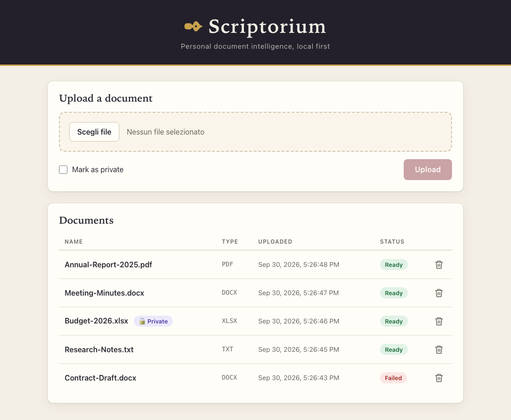

<div align="center">

# ✒ Scriptorium

**Personal document intelligence — local first.**

Upload your documents, keep them on your own machine, and let them become
something you can question, summarize and mine for entities.


[](https://github.com/github/spec-kit)

<picture>
  <source media="(prefers-color-scheme: dark)" srcset="docs/images/screenshot-dark.png">
  
</picture>

</div>

---

## ✨ What it does today

- 📄 **Upload** PDF, Word (`.docx`), Excel (`.xlsx`) and plain-text (`.txt`) files, up to 50 MB (configurable).
- ⚙️ **Extracts the text in the background.** Every document moves from *processing* to *ready*,
  or to *failed* with a human-readable reason (encrypted PDF, corrupted file, no extractable text…).
- 🗂 **Keeps the original and the text apart:** the file stays on disk, the extracted text lives in the database.
- 🔒 **Private flag** per document. A private document is always answered by the local model: it never reaches the cloud,
  whatever the preference or the settings.
- ♻️ **Rejects duplicates** by content (SHA-256), even when the file was renamed, and tells you which document it matches.
- 🗑 **Deletes documents** (record, extracted text and file) with a confirmation in the row.
- 📊 **Live list** that refreshes while documents are processing, with a progress bar during upload,
  clear error messages, and a dark theme that follows your system.
- 💬 **Asks questions about a document.** Click **Ask** on a ready document and chat with it: the answer is
  based only on the document's text, and it says so when the document does not contain the answer.
  Follow-up questions keep the context of the conversation; **New conversation** starts over, and the
  conversation is forgotten when you close the panel or reload the page.
- ✍️ **Notes digital signatures in PDFs.** For a digitally signed PDF the extracted text starts with the note
  "file firmato con firma digitale", followed by the signer's name when the file gives one (from the signature's
  name field or its certificate, otherwise "firmatario sconosciuto") and by the signing date and time, so you can ask who
  signed and when. The name is reported as the file declares it, with no validity check.
- 👁 **Shows the extracted text.** A ready document has a **Text** button that opens a read-only popup with the
  extracted text, cut at the same limit the model reads, and it says so ("Showing the first 8,000 of … characters")
  when the text is longer.
- 🔀 **Chooses the model for each question.** A small **Answer with** selector offers **Auto** (the default), **Local** and
  **Cloud**, and every answer says where it came from ("Answered on this computer" or "Answered by the cloud model").
  Auto sends a question to the cloud only when it looks demanding (a simple, explainable score) **and** the cloud is switched on.
  Cloud chosen while the cloud is off, or for a private document, gives a clear message and nothing is sent anywhere.
- 📝 **Summarises a document.** A **Summarise** button next to **Send** in the question panel writes one short paragraph
  (three to five sentences) from the document's text, in the language of the document. It reads the same first part of the
  text the questions read and says so when the document is longer ("This summary is based only on the first part…").
  A summary is produced each time you ask and **nothing is stored**. It uses the same **Answer with** selector and the same
  rules as the questions, and says where it came from ("Answered on this computer" or "Answered by the cloud model").
  A document with almost no text (under 50 characters) is not summarised.
- 🏷 **Extracts the entities of a document.** An **Extract entities** button next to **Summarise** lists the people,
  organizations, dates, amounts of money and places found in the text, grouped by type, each one once and as it is written in
  the document. Only what is really in the text is shown: an entity the model names that cannot be found in the text it was
  given is dropped. It reads the same first part of the text as the questions and says so when the document is longer. The
  result is produced each time you ask and **nothing is stored**. It uses the same **Answer with** selector and the same rules
  and label as the questions. A document with almost no text (under 50 characters) is refused without calling a model.
- 🏠 **Runs on your machine.** With the settings you get out of the box the cloud is **off**: questions and document text go
  only to the local [Ollama](https://ollama.com) server, nothing leaves your computer and nothing costs anything.

## 🗺 Roadmap

| | Feature | Status |
|---|---|---|
| ✅ | Document upload and parsing | Done |
| ✅ | Ask questions about a document | Done |
| ✅ | Summaries | Done |
| ✅ | Entity extraction | Done |
| ✅ | Model router: private documents → local **Ollama**, complex tasks → **Claude API**, manual override | Done; the cloud side is built but **off by default** and has never called the real service |
| ✅ | Docker Compose setup (with an Ollama service) | Done; the files have not been run on a real machine yet, the first start is still to be checked |

Scriptorium is single-user and local-first: no authentication, no multi-tenancy, no cloud storage.

## 🚀 Getting started

**Prerequisites:** the [.NET 10 SDK](https://dotnet.microsoft.com/download) and Node.js 20 or 22 (LTS) with npm.

To ask questions about a document you also need [Ollama](https://ollama.com) running on the same machine
with the model installed (uploading and browsing documents works without it):

```bash
ollama pull qwen3.5:4b
```

```bash
git clone https://github.com/maurytam/scriptorium.git
cd scriptorium

# 1. API — http://localhost:5034
dotnet run --project src/Scriptorium.API

# 2. Web UI, in a second terminal — http://localhost:4200
cd src/Scriptorium.Web
npm install
npm start
```

Open <http://localhost:4200>. The dev server proxies `/api` to the API, and the database is
created and migrated automatically on first start.

## 🐳 With Docker

An alternative to the setup above that needs **only Docker** (with Compose v2): no .NET, no Node, no Ollama on your computer.
One command starts the web page, the API and a local Ollama server.

> **Status:** these files are written but have not been built or run on a real machine yet. If the first start fails, the output
> says where; [`linux-requirements.html`](linux-requirements.html) lists what a Linux machine needs.

```bash
git clone https://github.com/maurytam/scriptorium.git
cd scriptorium
docker compose up --build
```

Then open <http://localhost:8080>. The page is published on your own computer only (`127.0.0.1`), on a port different from the
development ones (4200 and 5034), so both setups can run at the same time.

- **First start:** it builds the images and downloads the model `qwen3.5:4b` (about 3 GB) by itself, only if it is missing, and the
  progress is in the output. While the model is missing questions say it is not available; the rest of the app works. Later starts
  download nothing.
- **Stop:** `Ctrl+C`, or `docker compose stop`. `docker compose down` also removes the containers; the documents and the model are kept.
- **Where the data lives:** in Docker volumes (`scriptorium-data` for the database and the uploaded files, `ollama-models` for the
  models), never in the project folder, so nothing can be committed by mistake. `docker compose down -v` **deletes them**; the next start
  begins empty and downloads the model again.
- **Another port:** put `WEB_PORT=8081` (for example) in a file called `.env` next to `docker-compose.yml`. Git ignores `.env`.
  `OLLAMA_MODEL` in the same file changes the model.
- **The cloud is off.** It needs `ROUTING_CLOUD_ENABLED=true` **and** `ANTHROPIC_API_KEY=...` in the `.env` file, and it costs money;
  leave both out. Never commit that file.
- **No GPU:** inside Docker the model runs on the processor only. On a Mac, Docker cannot use the graphics chip, so it is clearly slower
  than the Ollama installed on the computer (the setup above), which does use it. An answer that takes longer than `Ollama:TimeoutSeconds`
  (120 seconds) gives the "model did not answer in time" message.
- **Using Docker does not change anything of the setup above:** the same code and settings, only the containers set where Ollama and
  the data are.

## ⚙️ Configuration

Settings live in [`src/Scriptorium.API/appsettings.json`](src/Scriptorium.API/appsettings.json).
Relative paths are resolved from the API project folder, and `App_Data/` is git-ignored.

| Key | Default | Meaning |
|---|---|---|
| `ConnectionStrings:Default` | `Data Source=App_Data/scriptorium.db` | SQLite database file |
| `Storage:LocalPath` | `App_Data/documents` | Where the original uploads are kept |
| `Documents:MaxSizeBytes` | `52428800` (50 MB) | Largest accepted upload |
| `Ollama:BaseUrl` | `http://localhost:11434` | Where the Ollama server listens |
| `Ollama:Model` | `qwen3.5:4b` | Model that answers the questions |
| `Ollama:NumCtx` | `8192` | Context window requested from the model, in tokens |
| `Ollama:TimeoutSeconds` | `120` | How long to wait for an answer before giving up |
| `Qa:MaxQuestionLength` | `2000` | Longest accepted question, in characters |
| `Qa:MaxDocumentCharacters` | `8000` | How much of the document is sent to the model; the rest is left out |
| `Qa:MaxHistoryExchanges` | `10` | Most recent earlier question/answer pairs kept in a conversation |
| `Qa:MaxHistoryCharacters` | `3000` | Cap on the characters of the kept history; the oldest pairs are dropped first |
| `Routing:CloudEnabled` | `false` | Switches the cloud model on. Off, every question is answered locally and choosing Cloud gives an error |
| `Routing:ComplexityThreshold` | `2` | With **Auto**, a question goes to the cloud only when its complexity score (0 to 5) is **above** this value |
| `Anthropic:ApiKey` | *(none)* | The cloud key. Set it only with `dotnet user-secrets` or an environment variable, **never in a file of the repository**. Without a key the cloud counts as not available |
| `Anthropic:Model` | `claude-sonnet-4-20250514` | Cloud model. Check that the id is still valid before ever switching the cloud on |
| `Anthropic:TimeoutSeconds` | `120` | How long to wait for the cloud before giving up |
| `Anthropic:MaxTokens` | `1024` | Longest answer asked of the cloud model |

Any key can also be set with an environment variable, using `__` for the colon (for example
`Ollama__Model=qwen3.5:9b`), or with `dotnet user-secrets` during development.

**The cloud is off.** Switching it on later is configuration only: `Routing:CloudEnabled=true` plus a key set with
`dotnet user-secrets set "Anthropic:ApiKey" "<your-key>" --project src/Scriptorium.API`. Both are needed: switched on without a key,
the cloud is still treated as not available. Using it costs money on your Anthropic account, which is why it is off.

## 🔌 API

| Method | Endpoint | Description |
|---|---|---|
| `POST` | `/api/documents` | Upload a file (`multipart/form-data`: `file`, optional `isPrivate`). `202`, or `400` unsupported type, `409` duplicate, `413` too large |
| `GET` | `/api/documents` | List documents, newest first |
| `GET` | `/api/documents/{id}` | Metadata and, if it failed, the reason |
| `GET` | `/api/documents/{id}/text` | Extracted text (`409` until the document is ready) |
| `GET` | `/api/documents/{id}/text/preview` | The extracted text cut at the limit the model reads: `content`, `truncated`, `totalCharacters` (`404` unknown document, `409` until it is ready) |
| `DELETE` | `/api/documents/{id}` | Delete a document (`409` while it is still processing) |
| `GET` | `/api/documents/limits` | Upload limits enforced by the server |
| `POST` | `/api/documents/{id}/ask` | Ask a question about a ready document (JSON: `question`, optional `history` of earlier exchanges, optional `preference`: `auto`, `local` or `cloud`). `200` with `answer`, `truncated` and `backend` (`local` or `cloud`), or `400` invalid question or preference, `404` unknown document, `409` document not ready or Cloud chosen for a private document, `503` the model (Ollama, or the cloud when chosen) not available, `504` no answer in time |
| `POST` | `/api/documents/{id}/summary` | Summarise a ready document: one short paragraph, nothing stored (optional JSON body with `preference`: `auto`, `local` or `cloud`; no body is `auto`). `200` with `summary`, `truncated` and `backend` (`local` or `cloud`), or `400` invalid preference, `404` unknown document, `409` document not ready, too little text to summarise, or Cloud chosen for a private document, `503` the model not available, `504` no answer in time. See [the contract](specs/006-summaries/contracts/summary-api.md) |
| `POST` | `/api/documents/{id}/entities` | Extract the entities of a ready document: people, organizations, dates, amounts and places, nothing stored (optional JSON body with `preference`: `auto`, `local` or `cloud`; no body is `auto`). `200` with `groups` (only the types found), `truncated` and `backend` (`local` or `cloud`), or `400` invalid preference, `404` unknown document, `409` document not ready, too little text, or Cloud chosen for a private document, `503` the model not available, `504` no answer in time, `500` the reply could not be read. See [the contract](specs/007-entity-extraction/contracts/entities-api.md) |
| `GET` | `/api/documents/ask/limits` | Longest accepted question, from `Qa:MaxQuestionLength` (the web page uses it for its character counter) |

The full contracts are in [`specs/001-document-upload-parsing/contracts/documents-api.md`](specs/001-document-upload-parsing/contracts/documents-api.md),
[`specs/002-ask-document-questions/contracts/ask-api.md`](specs/002-ask-document-questions/contracts/ask-api.md) and, for the
preference and the new answers, [`specs/005-model-router/contracts/ask-routing-api.md`](specs/005-model-router/contracts/ask-routing-api.md).

## 🧱 Architecture

```
src/
├── Scriptorium.Core/             entities, interfaces, DTOs, services, Result<T> — no infrastructure dependencies
├── Scriptorium.Infrastructure/   PdfPig and OpenXML parsers, EF Core + SQLite, file store, background queue, Ollama and cloud providers
├── Scriptorium.API/              ASP.NET Core minimal API
└── Scriptorium.Web/              Angular UI
tests/
├── Scriptorium.Core.Tests/
└── Scriptorium.Infrastructure.Tests/   unit tests and in-process API integration tests
specs/                            specification, plan, contracts and task list
docker-compose.yml                web + api + ollama in containers (see "With Docker")
```

- **Clean Architecture:** `Core` depends on nothing; everything else goes through interfaces defined there.
- **Errors as values:** failures travel as `Result<T>` instead of exceptions across layer boundaries.
- **Off the request thread:** parsing runs in a background queue, so a large file never blocks the API.
- **Local storage:** originals on disk, metadata and extracted text in SQLite.
- **Provider isolation:** the domain asks the model through `IAIProvider` and `ICloudAIProvider`; only `OllamaProvider` knows Ollama exists
  and only `ClaudeProvider` knows the cloud service exists. `ModelRouter` is the only place that chooses between them.
- **Stateless conversations:** the server keeps no chat; the web page sends the earlier exchanges with each question.

More detail, with the main flows as diagrams, in [`docs/architecture.md`](docs/architecture.md).

## 🧪 Tests

```bash
dotnet test                                   # unit and integration tests

cd src/Scriptorium.Web
npx ng test --watch=false --browsers=ChromeHeadless   # Angular specs (needs Chrome)
```

The integration tests start the API in-process against a throwaway database and folder.

## 🧭 Built with Spec Kit

Scriptorium is developed following **Spec-Driven Development**, using
[GitHub Spec Kit](https://github.com/github/spec-kit). The specification is the starting point,
and the code follows from it: every feature goes through the same steps.

1. **Constitution:** the project principles, in [`.specify/memory/constitution.md`](.specify/memory/constitution.md).
2. **Specify:** user stories, requirements and success criteria describe *what* and *why*.
3. **Plan:** the technical approach, research notes, data model and API contracts.
4. **Tasks:** an ordered, testable task list, grouped by user story.
5. **Implement:** the tasks are carried out one phase at a time, each reviewed before the next.

Everything for the first feature, document upload and parsing, lives in
[`specs/001-document-upload-parsing/`](specs/001-document-upload-parsing/): the specification,
plan, research, data model, API contracts, quickstart, task list and validation results.
The second feature, asking questions about a document, is in
[`specs/002-ask-document-questions/`](specs/002-ask-document-questions/). The model router is in
[`specs/005-model-router/`](specs/005-model-router/), the summaries in
[`specs/006-summaries/`](specs/006-summaries/) and the entity extraction in
[`specs/007-entity-extraction/`](specs/007-entity-extraction/). The Docker setup is in
[`specs/008-docker-compose/`](specs/008-docker-compose/) (specification only: its plan and tasks were skipped).

Each feature is built on its own branch and merged through a pull request. Project conventions
are in [`Claude.md`](Claude.md).

## 📜 License

Released under the [MIT License](LICENSE).
