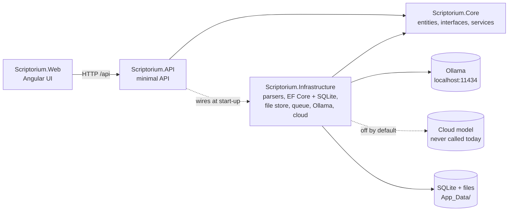
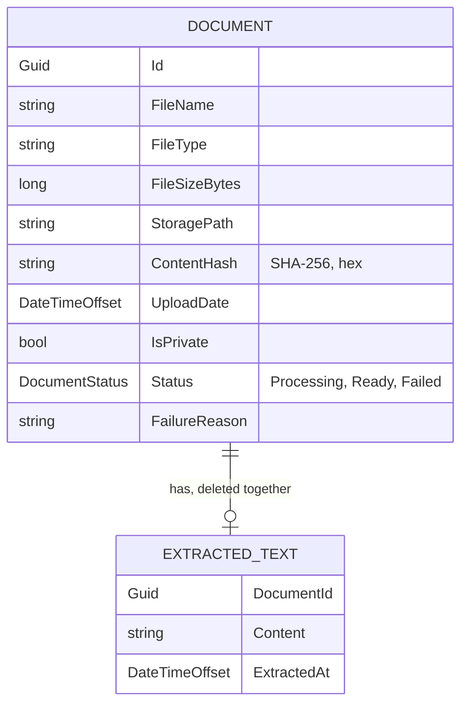
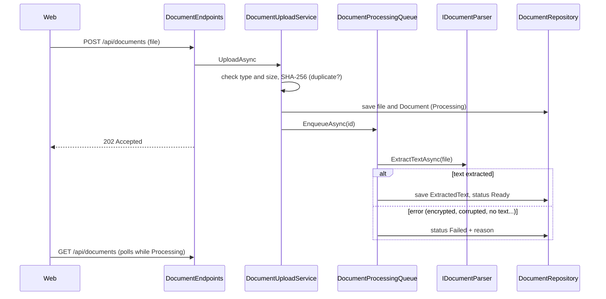
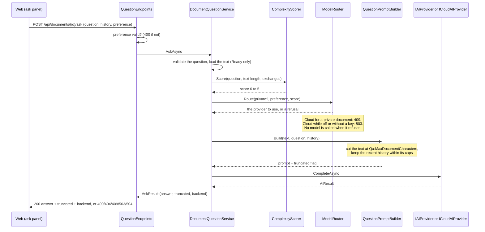

# Architecture

How Scriptorium is put together today. It describes what is built; what is only planned is said so (see the
roadmap in the [README](../README.md)). The decisions behind each feature are in `specs/<feature>/` (`research.md`, `plan.md`,
`contracts/`).

## 1. Layers

The one rule: **`Core` depends on nothing.** It defines the interfaces it needs; `Infrastructure` implements them and the API
connects the two in `Program.cs` (constructor injection only, no service locator). The API contains no business logic: an
endpoint reads the request, calls one Core service and maps its `Result` to an HTTP status.

| Project | Holds |
|---|---|
| `Scriptorium.Core` | `Document` and `ExtractedText`, the interfaces below, the services (use cases) including `ModelRouter` and `ComplexityScorer`, `Result<T>` and the typed results, DTOs, `QaOptions`, `RoutingOptions` |
| `Scriptorium.Infrastructure` | the four parsers, `DocumentRepository` (EF Core), `LocalFileStore`, `DocumentProcessingQueue`, `OllamaProvider`, `ClaudeProvider` |
| `Scriptorium.API` | `DocumentEndpoints`, `QuestionEndpoints`, `GlobalExceptionHandler`, `Program.cs` |
| `Scriptorium.Web` | the Angular app (standalone components and signals) |

## 2. The interfaces that matter

| Interface (in Core) | Implemented by | Purpose |
|---|---|---|
| `IDocumentParser` | `PdfDocumentParser`, `WordDocumentParser`, `ExcelDocumentParser`, `TextDocumentParser` | One per file type: `Stream` in, `Result<string>` with the text out. `SupportedFileType` is also how the upload service knows which types are accepted |
| `IDocumentRepository` | `DocumentRepository` | Documents and extracted text: add, read, list, delete, status, find by content hash |
| `IFileStore` | `LocalFileStore` | The original files on disk |
| `IDocumentProcessingQueue` | `DocumentProcessingQueue` | Hands a document to the background worker |
| `IAIProvider` | `OllamaProvider` | The only door to the local model: `CompleteAsync(AiRequest)` returns an `AiResult` |
| `ICloudAIProvider` | `ClaudeProvider` | The only door to the cloud model: the same `CompleteAsync`, plus `IsConfigured` (is there a key). Kept apart from `IAIProvider` so the router can tell the two backends apart and the local one can never be taken for the cloud one |

A parser added for a new file type is picked up by registering one more `IDocumentParser`; nothing else changes.

## 3. Data

The original file stays on disk (`Storage:LocalPath`); the metadata and the extracted text live in SQLite
(`ConnectionStrings:Default`). The database is created and migrated when the API starts.
`IsPrivate` is read by the model router: a private document is always answered locally. The router stores nothing; the preference
and the backend that answered travel with each request and response (section 4.2).

## 4. Flows

### 4.1 Upload and text extraction

The request returns as soon as the file is stored; the text is extracted afterwards, so a large file never blocks the API.

- A rejected upload (`400` type, `413` size, `409` duplicate by content) stores nothing.
- The queue is a bounded channel (100 documents) read by one `BackgroundService`; when it is full the upload fails with a
  message instead of waiting.
- Any unexpected error while processing marks that document `Failed` and the worker keeps going.
- A digitally signed PDF gets a note at the start of its text (who signed and when), built by `PdfSignatureNoteReader` from
  `SignerNameReader`, which in turn reads the certificate with `CmsSignerCertificateReader`; the signature is not validated.

### 4.2 Asking a question

- **Stateless:** the server keeps no conversation. The page sends the earlier exchanges with each question, and
  `QuestionPromptBuilder` keeps only the most recent ones (`Qa:MaxHistoryExchanges`, `Qa:MaxHistoryCharacters`).
- **The document is data, not instructions:** the text goes inside a fenced `<document>` block and a copy of the closing tag
  inside the text is neutralised.
- **Provider failures** come back as an `AiResult` with a kind; `DocumentQuestionService` turns *unavailable* and *timeout*
  into messages the user can act on (`503`, `504`) and everything else into a generic one, with no details.
- **No fallback:** a question routed to the cloud that fails is reported as it is; it is never retried on the local model.
- When the text was cut, the answer says so (`truncated`). The answer also says which backend produced it (`backend`).

### 4.3 Reading the extracted text

`GET /api/documents/{id}/text/preview` returns the text cut at the **same limit the model reads**, with `truncated` and
`totalCharacters`. Both this and the question flow call `TextExcerpt.Of(text, Qa:MaxDocumentCharacters)`, so the popup shows
exactly where the model's reading stops. The cut never ends on half of a character. `GET /api/documents/{id}/text` still
returns the whole text.

## 5. Cross-cutting rules

- **Errors as values.** Services and interfaces in Core return `Result`, `Result<T>` or a typed result (`UploadResult`,
  `AskResult`, `AiResult`, `DeleteResult`, `TextPreviewResult`), each with a failure *kind* that the endpoint maps to a status.
  Exceptions do not cross layer boundaries; `GlobalExceptionHandler` answers anything that escapes with a generic error and no
  details.
- **Registration.** Services, repository, file store, parsers, queue and provider are singletons; the repository uses a
  `DbContextFactory`, so each call gets its own short-lived context.
- **Configuration.** `appsettings.json`, with `Ollama:*`, `Qa:*`, `Routing:*`, `Anthropic:*`, `Documents:MaxSizeBytes`, `Storage:LocalPath` and the
  connection string; every key can be an environment variable. The cloud (`Routing:*`, `Anthropic:*`) is off by default and the
  Anthropic key goes in `dotnet user-secrets`, never in the repository. The table of keys is in the [README](../README.md).
- **Tests.** One test class per production class (xUnit, FluentAssertions, Moq); the Infrastructure tests also run the API
  in-process (`ApiTestHost`) against a throwaway database. The web app has its own Karma specs.

## 6. The web app

Standalone Angular components with signals, no state library.

| Piece | Role |
|---|---|
| `DocumentApiService` | The only place that calls the API (`HttpClient`) |
| `upload` | File picker, Private flag, progress and error messages |
| `document-list` | The list (refreshes while a document is processing), Ask, Text and Delete buttons |
| `ask-panel` + `ConversationSelectionService` | The question panel and its **Answer with** selector (Auto, Local, Cloud); the conversation and the choice live in the component and are forgotten on close or reload. It sends the preference and shows `backend`; it decides nothing |
| `text-popup` + `TextPopupSelectionService` | The read-only popup on a native `<dialog>`; it shows what the server sends and does no cutting |

Components are thin views: the cut, the limits and the rules live on the server. In development `ng serve` proxies `/api` to
the API on port 5034.

## 7. The model router

`ModelRouter` (in Core) is the **only place that chooses** between the local model and the cloud model. It compares facts and
hands a provider back; it never calls one. The rules, in this order:

1. a **private** document and the preference **Cloud**: refused (`409`), no model is called;
2. a **private** document: local;
3. the preference **Local**: local;
4. the preference **Cloud**: the cloud if it is usable, otherwise an explicit error (`503`), never a silent fallback;
5. the preference **Auto**: the cloud only if it is usable **and** the complexity score is above `Routing:ComplexityThreshold`
   (default 2), otherwise local.

The cloud is *usable* when `Routing:CloudEnabled` is true **and** the cloud provider has a key (`ICloudAIProvider.IsConfigured`).

**The complexity score** (`ComplexityScorer`) is one point for each of five signals, so 0 to 5, from the question text and two
numbers only, never the document text: a long question (400 characters or more), several questions in one (two or more `?`),
a long reading (the text the model reads is 75 % or more of `Qa:MaxDocumentCharacters`), a conversation under way (three or
more earlier exchanges) and reasoning words from a fixed English and Italian list (for example "compare", "explain why",
"confronta", "perché"). A score equal to the threshold stays local. Only the threshold is configuration; the signal limits are
constants with tests.

**The cloud provider** (`ClaudeProvider`, built on the official `Anthropic` package) is registered but **off by default**: the
delivered settings have `CloudEnabled=false` and no key, so every question goes to Ollama and nothing leaves the computer. It
creates its client only when there is a key, ignores a key found in the environment of the machine, does not retry, and maps its
failures to *unavailable* (no key, key refused, service unreachable), *timeout* and *failed*. Its single line that talks to the
real service has never been run: the tests exercise the library against canned replies and use a stand-in `ICloudAIProvider`
for the cloud-on cases.

Switching it on later is configuration only (`Routing:CloudEnabled=true` and `Anthropic:ApiKey` in `dotnet user-secrets`),
not a redesign. Check that the default model id is still valid first, and expect it to cost money.

Summaries and entity extraction are planned to go through the same router. The decisions, the data model and the contract are in
[`specs/005-model-router/`](../specs/005-model-router/).
