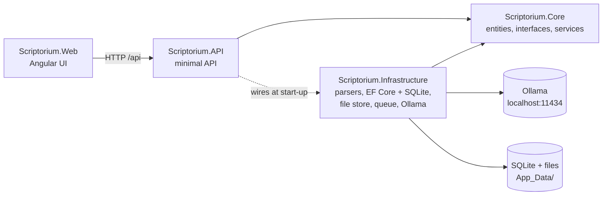
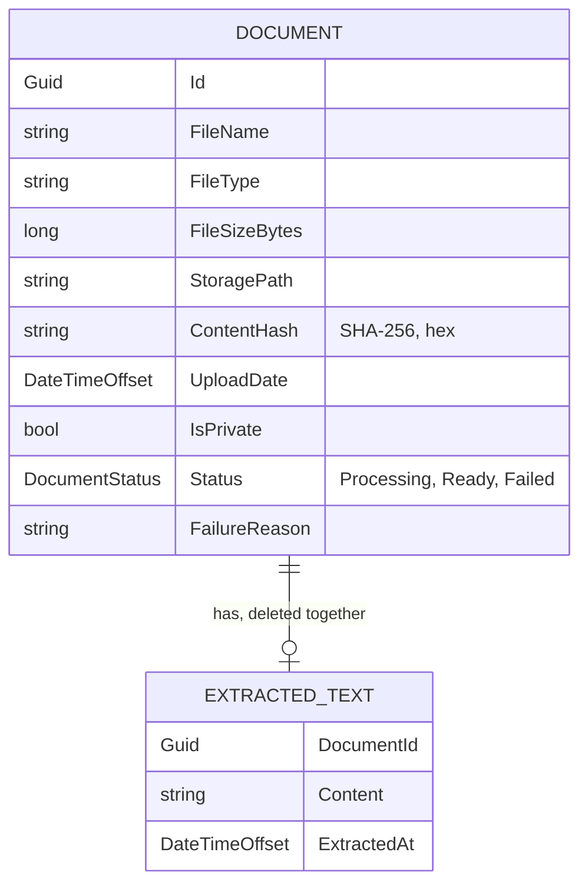
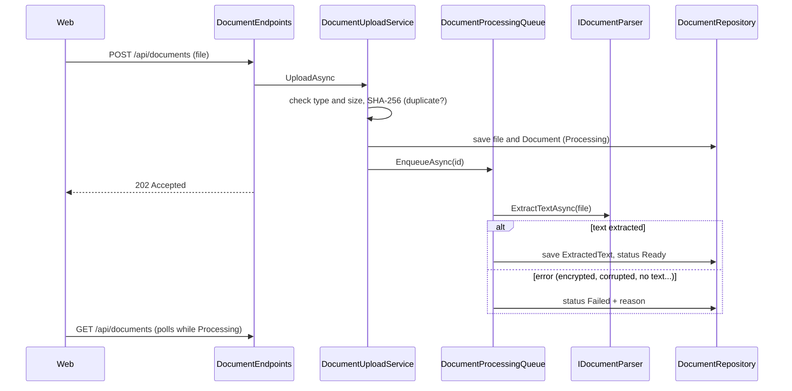
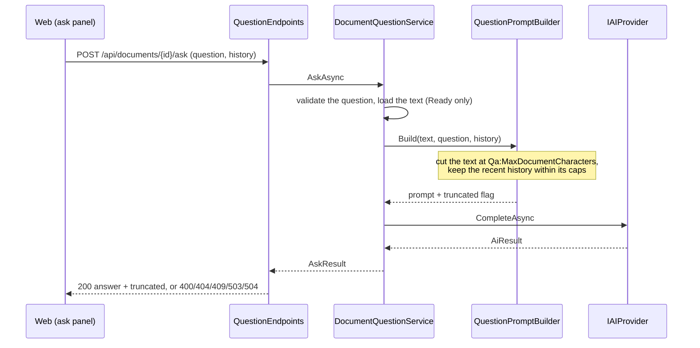

# Architecture

How Scriptorium is put together today. It describes what is built; what is only planned is said so (see the
roadmap in the [README](../README.md)). The decisions behind each feature are in `specs/<feature>/` (`research.md`, `plan.md`,
`contracts/`).

## 1. Layers

The one rule: **`Core` depends on nothing.** It defines the interfaces it needs; `Infrastructure` implements them and the API
connects the two in `Program.cs` (constructor injection only, no service locator). The API contains no business logic: an
endpoint reads the request, calls one Core service and maps its `Result` to an HTTP status.

| Project | Holds |
|---|---|
| `Scriptorium.Core` | `Document` and `ExtractedText`, the interfaces below, the services (use cases), `Result<T>` and the typed results, DTOs, `QaOptions` |
| `Scriptorium.Infrastructure` | the four parsers, `DocumentRepository` (EF Core), `LocalFileStore`, `DocumentProcessingQueue`, `OllamaProvider` |
| `Scriptorium.API` | `DocumentEndpoints`, `QuestionEndpoints`, `GlobalExceptionHandler`, `Program.cs` |
| `Scriptorium.Web` | the Angular app (standalone components and signals) |

## 2. The interfaces that matter

| Interface (in Core) | Implemented by | Purpose |
|---|---|---|
| `IDocumentParser` | `PdfDocumentParser`, `WordDocumentParser`, `ExcelDocumentParser`, `TextDocumentParser` | One per file type: `Stream` in, `Result<string>` with the text out. `SupportedFileType` is also how the upload service knows which types are accepted |
| `IDocumentRepository` | `DocumentRepository` | Documents and extracted text: add, read, list, delete, status, find by content hash |
| `IFileStore` | `LocalFileStore` | The original files on disk |
| `IDocumentProcessingQueue` | `DocumentProcessingQueue` | Hands a document to the background worker |
| `IAIProvider` | `OllamaProvider` | The only door to a model: `CompleteAsync(AiRequest)` returns an `AiResult` |

A parser added for a new file type is picked up by registering one more `IDocumentParser`; nothing else changes.

## 3. Data

The original file stays on disk (`Storage:LocalPath`); the metadata and the extracted text live in SQLite
(`ConnectionStrings:Default`). The database is created and migrated when the API starts.
`IsPrivate` is stored but nothing reads it yet: it is for the model router, which is planned.

## 4. Flows

### 4.1 Upload and text extraction

The request returns as soon as the file is stored; the text is extracted afterwards, so a large file never blocks the API.

- A rejected upload (`400` type, `413` size, `409` duplicate by content) stores nothing.
- The queue is a bounded channel (100 documents) read by one `BackgroundService`; when it is full the upload fails with a
  message instead of waiting.
- Any unexpected error while processing marks that document `Failed` and the worker keeps going.
- A digitally signed PDF gets a note at the start of its text (who signed and when), built by `PdfSignatureNoteReader` from
  `SignerNameReader`, which in turn reads the certificate with `CmsSignerCertificateReader`; the signature is not validated.

### 4.2 Asking a question

- **Stateless:** the server keeps no conversation. The page sends the earlier exchanges with each question, and
  `QuestionPromptBuilder` keeps only the most recent ones (`Qa:MaxHistoryExchanges`, `Qa:MaxHistoryCharacters`).
- **The document is data, not instructions:** the text goes inside a fenced `<document>` block and a copy of the closing tag
  inside the text is neutralised.
- **Provider failures** come back as an `AiResult` with a kind; `DocumentQuestionService` turns *unavailable* and *timeout*
  into messages the user can act on (`503`, `504`) and everything else into a generic one, with no details.
- When the text was cut, the answer says so (`truncated`).

### 4.3 Reading the extracted text

`GET /api/documents/{id}/text/preview` returns the text cut at the **same limit the model reads**, with `truncated` and
`totalCharacters`. Both this and the question flow call `TextExcerpt.Of(text, Qa:MaxDocumentCharacters)`, so the popup shows
exactly where the model's reading stops. The cut never ends on half of a character. `GET /api/documents/{id}/text` still
returns the whole text.

## 5. Cross-cutting rules

- **Errors as values.** Services and interfaces in Core return `Result`, `Result<T>` or a typed result (`UploadResult`,
  `AskResult`, `AiResult`, `DeleteResult`, `TextPreviewResult`), each with a failure *kind* that the endpoint maps to a status.
  Exceptions do not cross layer boundaries; `GlobalExceptionHandler` answers anything that escapes with a generic error and no
  details.
- **Registration.** Services, repository, file store, parsers, queue and provider are singletons; the repository uses a
  `DbContextFactory`, so each call gets its own short-lived context.
- **Configuration.** `appsettings.json`, with `Ollama:*`, `Qa:*`, `Documents:MaxSizeBytes`, `Storage:LocalPath` and the
  connection string; every key can be an environment variable. The Anthropic key (once the router exists) goes in
  `dotnet user-secrets`, never in the repository. The table of keys is in the [README](../README.md).
- **Tests.** One test class per production class (xUnit, FluentAssertions, Moq); the Infrastructure tests also run the API
  in-process (`ApiTestHost`) against a throwaway database. The web app has its own Karma specs.

## 6. The web app

Standalone Angular components with signals, no state library.

| Piece | Role |
|---|---|
| `DocumentApiService` | The only place that calls the API (`HttpClient`) |
| `upload` | File picker, Private flag, progress and error messages |
| `document-list` | The list (refreshes while a document is processing), Ask, Text and Delete buttons |
| `ask-panel` + `ConversationSelectionService` | The question panel; the conversation lives in the component and is forgotten on close or reload |
| `text-popup` + `TextPopupSelectionService` | The read-only popup on a native `<dialog>`; it shows what the server sends and does no cutting |

Components are thin views: the cut, the limits and the rules live on the server. In development `ng serve` proxies `/api` to
the API on port 5034.

## 7. Planned: the model router

Not built yet. The plan (see `CLAUDE.md`) is a `ModelRouter` in Core that picks the backend for each request: a document
flagged `IsPrivate` always goes to Ollama, a complex task goes to the Claude API, and the user can override it
(`ModelPreference`: Auto, Local, Cloud). It fits the present design without changing it: a second `IAIProvider`
(`ClaudeProvider`) next to `OllamaProvider`, with no Ollama and Claude logic in the same class. Summaries and entity extraction
are planned to use it from the start.
