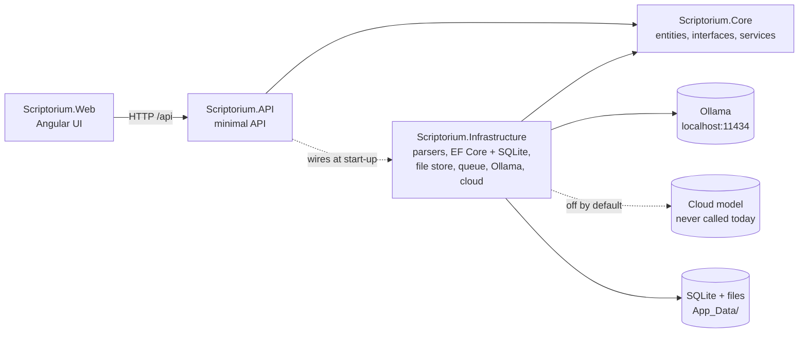
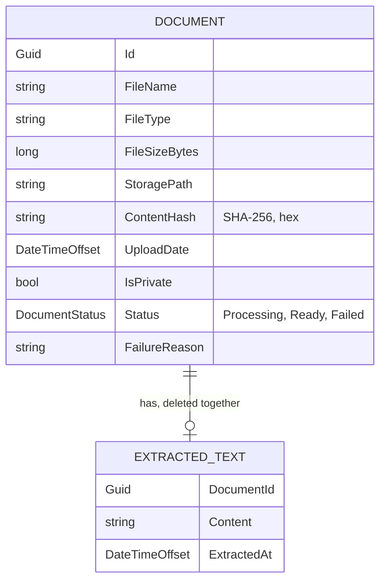
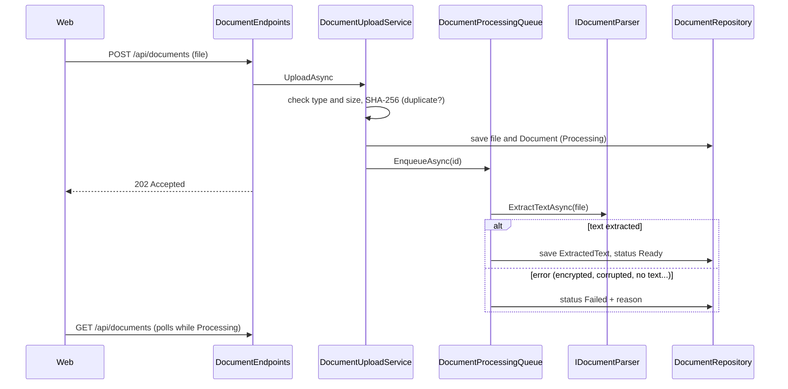
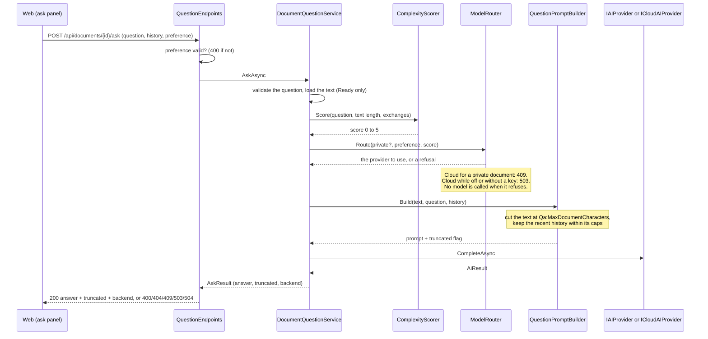
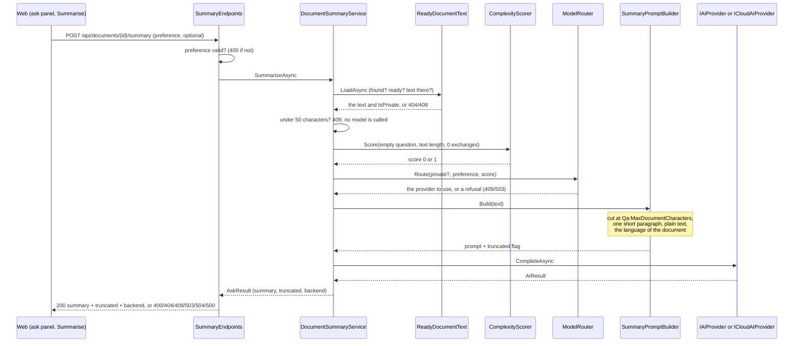
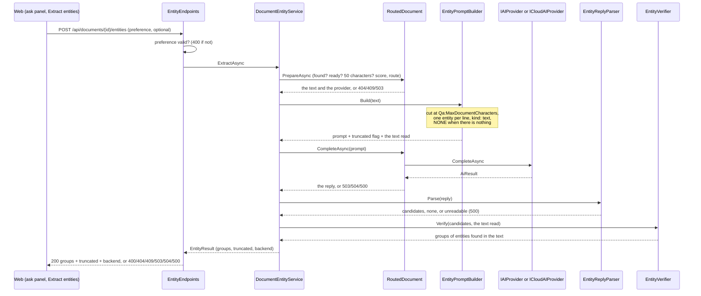
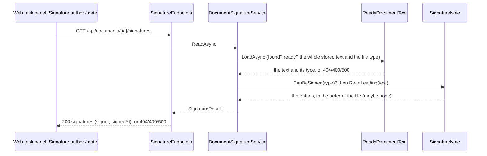
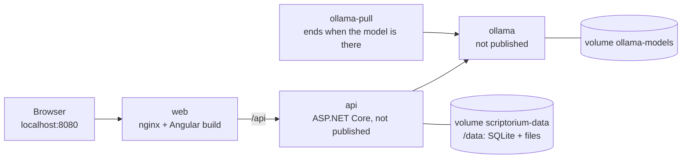

# Architecture

How Scriptorium is put together today. It describes what is built; what is only planned is said so (see the
roadmap in the [README](../README.md)). The decisions behind each feature are in `specs/<feature>/` (`research.md`, `plan.md`,
`contracts/`).

## 1. Layers

The one rule: **`Core` depends on nothing.** It defines the interfaces it needs; `Infrastructure` implements them and the API
connects the two in `Program.cs` (constructor injection only, no service locator). The API contains no business logic: an
endpoint reads the request, calls one Core service and maps its `Result` to an HTTP status.

| Project | Holds |
|---|---|
| `Scriptorium.Core` | `Document` and `ExtractedText`, the interfaces below, the services (use cases) including `DocumentQuestionService`, `DocumentSummaryService`, `DocumentEntityService`, `ModelRouter` and `ComplexityScorer`, the pieces the use cases share (`ReadyDocumentText`, `RoutedDocument`, `AskFailureMapper`, `PromptDocumentBlock`), the signature pieces (`SignatureNote`, the one definition of the signature line, `DocumentSignatureService`, `SignatureResult`), the entity pieces (`EntityPromptBuilder`, `EntityReplyParser`, `EntityVerifier`, `EntityType`, `EntityResult`), `Result<T>` and the typed results, DTOs, `QaOptions`, `RoutingOptions` |
| `Scriptorium.Infrastructure` | the four parsers (the Word and Excel ones wrapped by `SignedOfficeDocumentParser`, with `OfficeSignatureNoteReader`), `DocumentRepository` (EF Core), `LocalFileStore`, `DocumentProcessingQueue`, `OllamaProvider`, `ClaudeProvider` |
| `Scriptorium.API` | `DocumentEndpoints`, `QuestionEndpoints`, `SummaryEndpoints`, `EntityEndpoints`, `SignatureEndpoints`, the helpers the question, summary and entity endpoints use (`ModelPreferenceParser`, `AskFailureResponses`), `GlobalExceptionHandler`, `Program.cs` |
| `Scriptorium.Web` | the Angular app (standalone components and signals) |

## 2. The interfaces that matter

| Interface (in Core) | Implemented by | Purpose |
|---|---|---|
| `IDocumentParser` | `PdfDocumentParser`, `WordDocumentParser`, `ExcelDocumentParser`, `TextDocumentParser` | One per file type: `Stream` in, `Result<string>` with the text out. `SupportedFileType` is also how the upload service knows which types are accepted |
| `IDocumentRepository` | `DocumentRepository` | Documents and extracted text: add, read, list, delete, status, find by content hash |
| `IFileStore` | `LocalFileStore` | The original files on disk |
| `IDocumentProcessingQueue` | `DocumentProcessingQueue` | Hands a document to the background worker |
| `IAIProvider` | `OllamaProvider` | The only door to the local model: `CompleteAsync(AiRequest)` returns an `AiResult` |
| `ICloudAIProvider` | `ClaudeProvider` | The only door to the cloud model: the same `CompleteAsync`, plus `IsConfigured` (is there a key). Kept apart from `IAIProvider` so the router can tell the two backends apart and the local one can never be taken for the cloud one |

A parser added for a new file type is picked up by registering one more `IDocumentParser`; nothing else changes.

## 3. Data

The original file stays on disk (`Storage:LocalPath`); the metadata and the extracted text live in SQLite
(`ConnectionStrings:Default`). The database is created and migrated when the API starts.
`IsPrivate` is read by the model router: a private document is always answered locally. The router stores nothing; the preference
and the backend that answered travel with each request and response (section 4.2).

## 4. Flows

### 4.1 Upload and text extraction

The request returns as soon as the file is stored; the text is extracted afterwards, so a large file never blocks the API.

- A rejected upload (`400` type, `413` size, `409` duplicate by content) stores nothing.
- The queue is a bounded channel (100 documents) read by one `BackgroundService`; when it is full the upload fails with a
  message instead of waiting.
- Any unexpected error while processing marks that document `Failed` and the worker keeps going.
- A digitally signed PDF gets a note at the start of its text (who signed and when), built by `PdfSignatureNoteReader` from
  `SignerNameReader`, which in turn reads the certificate with `CmsSignerCertificateReader`; the signature is not validated.
- A signed Word or Excel file gets the same lines: `SignedOfficeDocumentParser` wraps the plain parser and puts in front of its
  text one line per signature read by `OfficeSignatureNoteReader` (the signature parts of the package, read as XML with DTDs
  prohibited; the signer is the common name of the signer's own certificate, not an authority of the chain; the date is the Office
  `SignatureTime`, or the XAdES `SigningTime` when only that is there). An unsigned file gives exactly the plain parser's text, and
  a signature that cannot be read adds no line and never fails the upload. The wording and layout of the line are defined once, in
  `SignatureNote` (Core), which both writers use and the signature buttons read back (section 4.6).

### 4.2 Asking a question

- **Stateless:** the server keeps no conversation. The page sends the earlier exchanges with each question, and
  `QuestionPromptBuilder` keeps only the most recent ones (`Qa:MaxHistoryExchanges`, `Qa:MaxHistoryCharacters`).
- **The document is data, not instructions:** the text goes inside a fenced `<document>` block and a copy of the closing tag
  inside the text is neutralised.
- **Provider failures** come back as an `AiResult` with a kind; `AskFailureMapper` turns *unavailable* and *timeout*
  into messages the user can act on (`503`, `504`) and everything else into a generic one, with no details. Loading a ready
  document (`ReadyDocumentText`) and fencing it (`PromptDocumentBlock`) are shared with the summary flow.
- **No fallback:** a question routed to the cloud that fails is reported as it is; it is never retried on the local model.
- When the text was cut, the answer says so (`truncated`). The answer also says which backend produced it (`backend`).

### 4.3 Reading the extracted text

`GET /api/documents/{id}/text/preview` returns the text cut at the **same limit the model reads**, with `truncated` and
`totalCharacters`. Both this and the question flow call `TextExcerpt.Of(text, Qa:MaxDocumentCharacters)`, so the popup shows
exactly where the model's reading stops. The cut never ends on half of a character. `GET /api/documents/{id}/text` still
returns the whole text.

### 4.4 Summarising a document

- **Shared steps.** The checks after the preference (document found, ready, enough text), the scoring, the routing and the call to the chosen provider are in `RoutedDocument`, which the entity flow (4.5) uses as well; `DocumentSummaryService` only builds the prompt and hands the reply on.
- **Nothing is stored.** No entity, no column, no cache: the summary exists in the response and on the page. Asking again runs
  the model again.
- **Same rules as a question.** The same `ModelRouter`, the same preference, the same refusals and the same messages
  (`AskFailureMapper` and `AskFailureResponses` are shared), and no fallback when the cloud fails. The order of checks is
  preference, document found, ready, enough text, routing, model; a refusal before the model never calls it.
- **A model that answers with nothing** gives a generic `500`, never an empty summary.
- **The cut is the question's:** `SummaryPromptBuilder` uses `TextExcerpt.Of(text, Qa:MaxDocumentCharacters)` and the same fenced
  `<document>` block, so a summary reads the first part the questions and the text popup show; the page says so when `truncated`.

### 4.5 Extracting entities

- **Nothing is stored.** No entity, no column, no cache: the entities exist in the response and on the page.
- **Same rules as a question or a summary.** The same `ModelRouter`, preference, refusals, messages and no fallback; the order of
  checks is preference, document found, ready, enough text, routing, model, and a refusal before the model never calls it.
- **The model's reply is not trusted.** The prompt asks for one `kind: text` per line (no JSON, so `AiRequest` and the providers
  are unchanged). `EntityReplyParser` reads the lines; `EntityVerifier` keeps an entity only if its text is found in the exact
  text the model was given (`EntityPrompt.TextRead`), ignoring letter case and runs of white space. It is shown as the document
  writes it, once, in order of first appearance, and the types come in a fixed order (people, organizations, dates, amounts,
  places). What is not in the text is dropped, so a date the model rewrites (for example `5 March` for `05/03`) is dropped too.
- **A reply with nothing, or that cannot be read**, is `"groups": []` for a clear `NONE`, and a generic `500` ("The entities could
  not be extracted.") when no line makes sense. A type with no entity is not in the response.
- **Same cut as the questions:** `TextExcerpt.Of(text, Qa:MaxDocumentCharacters)`; the page says so when `truncated`.

### 4.6 Reading the signatures

- **No model.** The router, the scorer and the providers are not involved, so it is instant, needs no Ollama and sends nothing
  anywhere; the page ignores the **Answer with** choice for these two buttons.
- **Read from the text, not from the file.** The signature lines were written at upload (4.1) at the start of the stored text, so the
  original file is never opened again. `SignatureNote.ReadLeading` takes the lines from the first line on, until a blank line or the
  end of the text; the same wording further down, or in a text file, is not a signature. Only `pdf`, `docx` and `xlsx` are looked at.
- **The whole text is read**, not the part a model would read, so a long document still shows its signatures.
- **Nothing is stored and nothing is validated:** the name and date are what the file declares (the page says so). A document with no
  line gives an empty list ("no digital signature"); a document uploaded before its signatures were read has no line either.
- **Known limit:** nothing but the text is kept, so an unsigned file whose first lines are exactly in the note format followed by a blank
  line would be taken for signed. Telling them apart would need stored metadata (a migration); the project chose to store nothing.

## 5. Cross-cutting rules

- **Errors as values.** Services and interfaces in Core return `Result`, `Result<T>` or a typed result (`UploadResult`,
  `AskResult`, `AiResult`, `DeleteResult`, `TextPreviewResult`), each with a failure *kind* that the endpoint maps to a status.
  Exceptions do not cross layer boundaries; `GlobalExceptionHandler` answers anything that escapes with a generic error and no
  details.
- **Registration.** Services, repository, file store, parsers, queue and provider are singletons; the repository uses a
  `DbContextFactory`, so each call gets its own short-lived context.
- **Configuration.** `appsettings.json`, with `Ollama:*`, `Qa:*`, `Routing:*`, `Anthropic:*`, `Documents:MaxSizeBytes`, `Storage:LocalPath` and the
  connection string; every key can be an environment variable. The cloud (`Routing:*`, `Anthropic:*`) is off by default and the
  Anthropic key goes in `dotnet user-secrets`, never in the repository. The table of keys is in the [README](../README.md).
- **Tests.** One test class per production class (xUnit, FluentAssertions, Moq); the Infrastructure tests also run the API
  in-process (`ApiTestHost`) against a throwaway database. The web app has its own Karma specs.

## 6. The web app

Standalone Angular components with signals, no state library.

| Piece | Role |
|---|---|
| `DocumentApiService` | The only place that calls the API (`HttpClient`) |
| `upload` | File picker, Private flag, progress and error messages |
| `document-list` | The list (refreshes while a document is processing), Ask, Text and Delete buttons |
| `ask-panel` + `ConversationSelectionService` | The question panel and its **Answer with** selector (Auto, Local, Cloud); the conversation and the choice live in the component and are forgotten on close or reload. Two more buttons, **Signature author** and **Signature date**, ask the server for the signatures of the open document (no model, so the selector does not apply) and show the signers or the dates in their own cards. A **Summarise** button and an **Extract entities** button next to **Send** ask for a summary or the entities of the open document with the same selector; each is a card above the conversation (the entities as one block per type), never part of the history sent with a question, and is dropped with the conversation; asking again replaces only that button's own card, so a summary and the entities can be on the page together. It sends the preference and shows `backend` and the `truncated` note; it decides nothing |
| `text-popup` + `TextPopupSelectionService` | The read-only popup on a native `<dialog>`; it shows what the server sends and does no cutting |

Components are thin views: the cut, the limits and the rules live on the server. In development `ng serve` proxies `/api` to
the API on port 5034.

## 7. Running with Docker

`docker-compose.yml` runs the same code in containers. It changes no behaviour: it only sets where Ollama and the data are
(environment variables of the same settings the README lists).

| Part | Role |
|---|---|
| `web` | Built from `src/Scriptorium.Web/Dockerfile`: the Angular app compiled once and served by nginx. It is the only part published on the computer (`127.0.0.1:${WEB_PORT:-8080}`). `nginx.conf` forwards `/api` to the API, never refuses an upload (the API has its own limit) and waits up to 600 seconds for an answer, more than the API's own time limit for the model. The API's address is looked up again every 10 seconds, so a rebuilt API is found |
| `api` | Built from `src/Scriptorium.API/Dockerfile` (the context is the project root, since it needs Core and Infrastructure) and run as a non-root user. It sets `Ollama__BaseUrl=http://ollama:11434`, the database and the files under `/data`, and the cloud off. It does not wait for the model: while it is missing, questions get the usual "model not available" message |
| `ollama` | The official image, not published; models in the `ollama-models` volume |
| `ollama-pull` | A start-up step: if the configured model is not in `ollama list` it runs `ollama pull`, then it ends. A later start finds the model and downloads nothing |

- **Data** lives in the two volumes, never in the project folder; only `docker compose down -v` removes them.
- **Cloud:** `Routing__CloudEnabled` and `Anthropic__ApiKey` come from an untracked `.env`; the delivered values are off and empty.
- **Images** never contain uploaded documents or secrets: the `.dockerignore` files leave out `App_Data`, `.env` and the build folders.
- **Status:** written but not yet built or run on a real machine. The decisions are in `specs/008-docker-compose/spec.md`.

## 8. The model router

`ModelRouter` (in Core) is the **only place that chooses** between the local model and the cloud model. It compares facts and
hands a provider back; it never calls one. The rules, in this order:

1. a **private** document and the preference **Cloud**: refused (`409`), no model is called;
2. a **private** document: local;
3. the preference **Local**: local;
4. the preference **Cloud**: the cloud if it is usable, otherwise an explicit error (`503`), never a silent fallback;
5. the preference **Auto**: the cloud only if it is usable **and** the complexity score is above `Routing:ComplexityThreshold`
   (default 2), otherwise local.

The cloud is *usable* when `Routing:CloudEnabled` is true **and** the cloud provider has a key (`ICloudAIProvider.IsConfigured`).

**How Auto scores a summary:** the same scorer, called with an empty question and no earlier exchanges. Only the long-reading
signal can fire, so the score is 0 or 1 and, with the default threshold of 2, Auto always answers a summary locally. It follows the
threshold the person already configures; there is no separate rule for summaries. Cloud chosen by hand works as for a question.

**The complexity score** (`ComplexityScorer`) is one point for each of five signals, so 0 to 5, from the question text and two
numbers only, never the document text: a long question (400 characters or more), several questions in one (two or more `?`),
a long reading (the text the model reads is 75 % or more of `Qa:MaxDocumentCharacters`), a conversation under way (three or
more earlier exchanges) and reasoning words from a fixed English and Italian list (for example "compare", "explain why",
"confronta", "perché"). A score equal to the threshold stays local. Only the threshold is configuration; the signal limits are
constants with tests.

**The cloud provider** (`ClaudeProvider`, built on the official `Anthropic` package) is registered but **off by default**: the
delivered settings have `CloudEnabled=false` and no key, so every question goes to Ollama and nothing leaves the computer. It
creates its client only when there is a key, ignores a key found in the environment of the machine, does not retry, and maps its
failures to *unavailable* (no key, key refused, service unreachable), *timeout* and *failed*. Its single line that talks to the
real service has never been run: the tests exercise the library against canned replies and use a stand-in `ICloudAIProvider`
for the cloud-on cases.

Switching it on later is configuration only (`Routing:CloudEnabled=true` and `Anthropic:ApiKey` in `dotnet user-secrets`),
not a redesign. Check that the default model id is still valid first, and expect it to cost money.

**How Auto scores an extraction:** the same as a summary (empty question, no earlier exchanges, score 0 or 1), so with the default threshold Auto answers locally.

Summaries (4.4) and entity extraction (4.5) go through the same router. The decisions, the data model and the
contract of the router are in [`specs/005-model-router/`](../specs/005-model-router/), those of the summaries in
[`specs/006-summaries/`](../specs/006-summaries/) and those of the entity extraction in
[`specs/007-entity-extraction/`](../specs/007-entity-extraction/).
